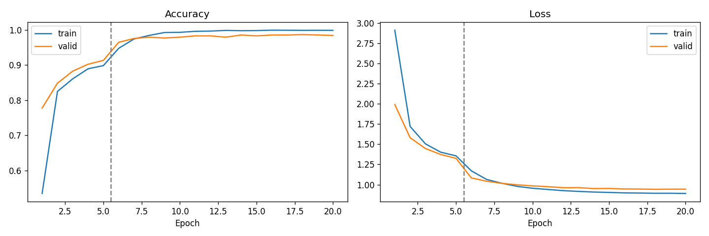

# Flower-Species-Classification
Flower species classification competition using PyTorch and transfer learning.

**SENG 481 — Grup üyeleri:** Fatma Zehra Anbar · Sinem Sarıçiçek · İrem Nur Yavuz · Zeynep Seray Uğur

## Kurulum

> **Python sürümü:** 3.9–3.12 arası çalışıyor (proje venv'i 3.9.6 ile doğrulandı,
> ayrıca 3.11'de de test edildi). `torch==2.8.0` çok yeni Python sürümleri
> (3.14+) için henüz derlenmiş wheel sunmuyor.
>
> **Anaconda/conda kullanıyorsanız dikkat:** Eğer bir conda ortamı (ör. `base`
> veya kendi ortamınız) aktifse, `python3` komutu o ortamın Python'una işaret
> edebilir — bu PyTorch'un desteklemediği çok yeni bir sürüm olabilir ve
> `pip install -r requirements.txt` "Could not find a version that satisfies
> the requirement torch==2.8.0" hatasıyla başarısız olur. Venv'i oluşturmadan
> önce `conda deactivate` çalıştırın (gerekirse birden fazla kez) ya da
> `python3 --version`'ı kontrol edip doğrudan sistem Python'unu kullanın
> (macOS'ta genelde `/usr/bin/python3`).

**macOS / Linux:**

```bash
# conda aktifse önce: conda deactivate
python3 -m venv venv
source venv/bin/activate
python3 --version   # 3.9-3.12 aralığında olmalı
pip install -r requirements.txt
```

**Windows (PowerShell):**

```powershell
# conda aktifse önce: conda deactivate
py -3.11 -m venv venv          # "py" yoksa: python -m venv venv
.\venv\Scripts\Activate.ps1
python --version               # 3.9-3.12 aralığında olmalı
pip install -r requirements.txt
```

> `Activate.ps1` "running scripts is disabled" hatası verirse, aynı pencerede önce
> `Set-ExecutionPolicy -Scope Process -ExecutionPolicy Bypass` çalıştırın (yalnızca
> o PowerShell penceresi için geçerlidir).

Tahmin (iki sistemde de aynı):

```bash
python predict.py --image path/to/flower.jpg --top-k 3
```

Veri setini indirip aç (yalnızca notebook'ları yeniden çalıştırmak için gerekir):

**macOS / Linux:**

```bash
mkdir -p data
curl -L -o data/flower_data.tar.gz https://s3.amazonaws.com/content.udacity-data.com/nd089/flower_data.tar.gz
tar -xzf data/flower_data.tar.gz -C data/
curl -L -o data/cat_to_name.json https://raw.githubusercontent.com/udacity/aipnd-project/master/cat_to_name.json
```

**Windows (PowerShell):** (`curl.exe` ve `tar` Windows 10/11'de yerleşik gelir)

```powershell
mkdir data -Force
curl.exe -L -o data/flower_data.tar.gz https://s3.amazonaws.com/content.udacity-data.com/nd089/flower_data.tar.gz
tar -xzf data/flower_data.tar.gz -C data/
curl.exe -L -o data/cat_to_name.json https://raw.githubusercontent.com/udacity/aipnd-project/master/cat_to_name.json
```

Bu işlemler sonunda `data/train`, `data/valid`, `data/test` (her biri 102 sınıf
klasörü) ve `data/cat_to_name.json` oluşur. `data/` git'e eklenmez (`.gitignore`).

## Takım Görev Dağılımı

| Üye | Görev | Teslimler |
|---|---|---|
| Fatma Zehra Anbar | Ana Model ve Eğitim Altyapısı (EfficientNet-B0, veri hazırlama) | `dataset.py`, `efficientnet.ipynb`, `checkpoints/efficientnet_b0_final.pth` |
| Sinem Sarıçiçek | Model Optimizasyonu ve Final Entegrasyon (MobileNetV3-Large) | `mobilenet.ipynb`, `evaluate.py`, `predict.py`, `checkpoints/mobilenetv3_finetuned_best.pth` |
| İrem Nur Yavuz | Genelleme ve Alternatif Model (CLIP) | `clip.ipynb`, `generalization_tests.py`, `results/` |
| Zeynep Seray Uğur | Güçlü Model ve Performans Analizi (EfficientNetV2-S) | `efficientnetv2.ipynb`, `metrics.py`, `efficientnetv2_best.pth` |

### Model Dosyaları (Google Drive)

Tüm model dosyaları Drive'da da paylaşılıyor (EfficientNetV2-S yalnızca Drive'da; boyutu nedeniyle repoya eklenmedi).

| Model | Dosya | Boyut | Test accuracy |
|---|---|---|---|
| EfficientNet-B0 (final model) | [efficientnet_best.pth](https://drive.google.com/file/d/1Ufxp-rc-5xUNwibXHM_1FMGrxyA5Egsw/view) | 16.07 MB | %99.02 |
| MobileNetV3-Large | [mobilenetv3_finetuned_best.pth](https://drive.google.com/file/d/1sFwhuMuLw__O_Rte330FyNHgeeRk9qsk/view?usp=sharing) | 16.73 MB | %94.87 (valid %96.94) |
| EfficientNetV2-S | [efficientnetv2_best.pth](https://drive.google.com/file/d/1Pxuz-DyhDthYKstTQ_-KiJXFqRAU5Svq/view?usp=sharing) | 39.28 MB (fp16) | %98.17 |

Final model (EfficientNet-B0, PyTorch: `checkpoints/efficientnet_b0_final.pth`) repoda
bulunuyor; `predict.py` varsayılan olarak bunu kullanır ve ek indirme gerektirmez. Aynı
modelin ONNX hali (`onnx/efficientnet_b0_fp32.onnx`) ve MobileNetV3 checkpoint'i
(`checkpoints/mobilenetv3_finetuned_best.pth`) da repoda; Drive linkleri yedek olarak duruyor.

---

## Fatma Zehra Anbar — EfficientNet-B0 (Final Model) ve Eğitim Altyapısı

### Ortak veri kodu (`dataset.py`)

Bütün modeller aynı veri kodunu kullanır:

```python
from dataset import get_dataloaders
train_loader, valid_loader, test_loader, classes = get_dataloaders("data/")
```

- **Sınıf sırası sayısal:** klasör `"1"` → 0, `"2"` → 1, …, `"102"` → 101.
  `ImageFolder`'ın alfabetik sırası (`1, 10, 100, …`) düzeltildi; `class_to_idx.json` ile aynıdır.
- **Inference preprocessing:** `Resize(256)` → `CenterCrop(224)` → `ToTensor` → ImageNet normalize
  (mean `[0.485, 0.456, 0.406]`, std `[0.229, 0.224, 0.225]`).
- **Train augmentation:** sadece eğitimde kullanılır, valid/test/tahminde kullanılmaz.

### Eğitim (`efficientnet.ipynb`)

ImageNet ağırlıklı `torchvision.models.efficientnet_b0`, son katman `Linear(1280, 102)` olarak değiştirildi.

| Aşama | Ne eğitildi | Epoch | Learning rate |
|---|---|---|---|
| 1 | Sadece son katman (gövde donduruldu) | 5 | 1e-3 |
| 2 | Tüm model (fine-tuning) | 15 | 3e-4, cosine azalma |

Ortak ayarlar: AdamW (weight decay 1e-4), label smoothing 0.1, batch size 32,
güçlü augmentation (RandomResizedCrop 0.5–1.0, yatay çevirme, TrivialAugmentWide, RandomErasing).
En iyi model valid accuracy'ye göre seçildi; test setine sadece en sonda bir kez bakıldı.



### Hyperparameter / augmentation denemeleri

| Deneme | Augmentation | LR (aşama 2) | Valid acc |
|---|---|---|---|
| 0 – baseline | standart | 1e-4 | 98.66% |
| 1 | güçlü | 1e-4 | 98.90% |
| **2 – final** | **güçlü** | **3e-4** | **99.63%** |
| 3 | güçlü | 6e-4 | 99.51% |

Tablo: `results/efficientnet_experiments.csv`. Learning rate 3e-4 civarında en iyi sonucu verdi.
Valid accuracy doygunluğa ulaştığı için batch size denemesi yapılmadı.

### Final sonuçlar

| Metrik | Değer |
|---|---|
| Valid accuracy | 99.63% |
| Test accuracy (819 görüntü) | **99.02%** |
| Model boyutu (`.pth`) | 16.07 MB |
| CPU süresi (sadece model, Colab 1 thread) | ~42–48 ms/görüntü |

### Doğrulama

- Drive'daki `efficientnet_best.pth`, kazanan deneme dosyasıyla birebir aynı (MD5).
- `.pth` ve `onnx/efficientnet_b0_fp32.onnx` aynı test setinde: **ikisi de 99.02%**,
  819/819 görüntüde aynı tahmin, en büyük çıktı farkı 0.000088.

### PyTorch ile yükleme

```python
import torch, torch.nn as nn
from torchvision import models

model = models.efficientnet_b0(weights=None)
model.classifier[1] = nn.Linear(1280, 102)
model.load_state_dict(torch.load("checkpoints/efficientnet_b0_final.pth", map_location="cpu"))
model.eval()
```

---

## Sinem Sarıçiçek — MobileNetV3-Large ve Final Model Entegrasyonu

### MobileNetV3-Large

MobileNetV3-Large modeli, Oxford Flowers 102 veri seti üzerinde
transfer learning kullanılarak eğitildi.

Modelin PyTorch ve ONNX sürümleri karşılaştırıldı ve
CPU inference performansı değerlendirildi.

Sonuçlar:

| Metrik | Değer |
|---|---|
| Validation Accuracy | 96.94% |
| Test Accuracy | 94.87% |
| ONNX CPU Inference | 9.14 ms/image |
| ONNX Model Size | 16.80 MiB |

Test doğruluğu, 819 test görüntüsü üzerinde bağımsız olarak hesaplandı.

### Final Model Selection

Four models were compared using classification accuracy,
CPU inference latency, and model size.

| Model | Test Accuracy | CPU Latency | Model Size |
|---|---:|---:|---:|
| **EfficientNet-B0 (final, PyTorch)** | **99.02%** | **24.41 ms** ¹ | **16.07 MB** |
| EfficientNet-B0 (ONNX alternatifi) | 99.02% | 13.31 ms ¹ | 15.78 MiB |
| MobileNetV3-Large (PyTorch) | 94.87% | 21.42 ms ² | 16.73 MB |
| EfficientNetV2-S (PyTorch, fp16) | 98.17% | 119.62 ms ³ | 39.28 MB |
| CLIP ViT-B/32 (zero-shot) | 66.54% | 56.58 ms | 577.08 MB |

¹ Windows CPU, 1 thread, batch 1, görüntü okuma + ön işlem dahil (30 tekrarın en düşüğü).
² Aynı Windows bilgisayar, 30 tekrarın ortalaması (MobileNetV3 ONNX: 9.14 ms, 16.80 MiB).
³ Colab CPU, 1 thread, yalnızca model (ONNX fp32: 108.59 ms, 77.32 MiB).

Note: CPU benchmarks were not all performed on identical hardware.

EfficientNet-B0 was selected as the final inference model
because of its high accuracy and efficient CPU performance.

### Final Inference Pipeline

The final prediction pipeline runs **EfficientNet-B0 with PyTorch on CPU** by default
(`--model efficientnet_b0_pytorch`). The same model is also available as ONNX
(`--model efficientnet_b0_onnx`, faster; identical predictions on all 819 test images).

Required files:

- `predict.py`
- `predict_shared.py`
- `shared_model_loader.py`
- `model_registry.json`
- `class_to_idx.json`
- `cat_to_name.json`
- `checkpoints/efficientnet_b0_final.pth` (varsayılan, PyTorch)
- `onnx/efficientnet_b0_fp32.onnx` (isteğe bağlı, ONNX)

Run inference:

```bash
python predict.py --image path/to/flower.jpg --top-k 3
```

#### Ek kullanım seçenekleri

```bash
# Klasördeki tüm görüntüler (alt klasörler dahil). Alt klasör adları sınıf
# numarasıysa (ör. test/47/x.jpg) top-1 accuracy de hesaplanır.
python predict.py --image-dir path/to/images --top-k 1 --output results.json

# Aynı final model, ONNX Runtime ile (daha hızlı; PyTorch ile 819/819 aynı tahmin)
python predict.py --image path/to/flower.jpg --model efficientnet_b0_onnx

# Diğer model
python predict.py --image path/to/flower.jpg --model mobilenetv3_pytorch
```

Python içinden (model ilk çağrıda bir kez yüklenir, sonraki çağrılar hızlıdır):

```python
from predict import predict
result = predict("flower.jpg", top_k=3)
result["predictions"][0]   # {"class_name": "rose", "class_id": "74", "class_index": 73, "confidence": 0.97}
```

- `class_id` veri setindeki klasör numarasıdır (1–102), `class_name` çiçek adıdır.
- Telefon fotoğraflarındaki EXIF yön bilgisi otomatik uygulanır.
- ONNX modeli seçildiğinde (`--model efficientnet_b0_onnx`) ONNX Runtime tüm CPU
  çekirdeklerini kullanır; tek thread ölçüm için `FLOWER_NUM_THREADS=1` verilebilir.

---

## İrem Nur Yavuz — Genelleme ve Alternatif Model (CLIP)

CLIP (`openai/clip-vit-base-patch32`) ile zero-shot/few-shot sınıflandırma,
veri setinde olmayan türlerle genelleme testi, görüntü bozulmalarına
dayanıklılık testi ve ana modellerle karşılaştırma.

```bash
# Tüm deneyleri çalıştır (clip.ipynb'nin zero-shot/few-shot adımları ayrıca çalıştırılmalı)
jupyter nbconvert --to notebook --execute --inplace clip.ipynb

# OOD / bozulma / karşılaştırma testleri
python generalization_tests.py --task all
```

Sonuçlar `results/` altında: `clip_metrics.json`, `clip_few_shot_results.json`,
`ood_results.json`, `corruption_robustness.json/png`, `comparison_table.csv`,
`comparison_chart.png`, `GENERALIZATION_REPORT.md`.

Diğer üyelerin `results/<model>_metrics.json` dosyalarını (aynı şema:
`model_name`, `accuracy`, `inference_ms_per_image`, `model_size_mb`, `device`)
eklemesiyle `--task compare` tam karşılaştırma tablosunu otomatik üretir.

**Teslim doğrulama notu:** `requirements.txt`, sıfır bir sanal ortamda
(`python3 -m venv` + `pip install -r requirements.txt`, Python 3.9.6) baştan
test edildi. İki sorun bulunup düzeltildi: (1) `onnxruntime==1.31.1` Python 3.9
için yayınlanmadığından, 3.9–3.12'nin hepsini destekleyen `1.19.2` sürümüne
sabitlendi; (2) conda ortamı aktifken `python3`'ün çok yeni/boş bir Python'a
işaret edip kurulumu bozabileceği görüldü, bu kılavuza yukarıda eklendi.
Düzeltmeden sonra tüm paketler (`torch`, `torchvision`, `transformers`,
`onnxruntime`, `scikit-learn` vb.) temiz bir ortamda sorunsuz kuruldu ve
import edildi.

---

## Zeynep Seray Uğur — EfficientNetV2-S ve Performans Analizi

ImageNet ağırlıklı **EfficientNetV2-S** (`torchvision`), ortak `dataset.py` ile
fine-tune edildi (gövde düşük LR, sınıflandırıcı 10× LR, AMP, label smoothing 0.1,
OneCycle LR, early stopping). Tüm adımlar ve çıktılar `efficientnetv2.ipynb` içinde;
metrik/puan fonksiyonları `metrics.py`'de.

**Model dosyası:** [efficientnetv2_best.pth](https://drive.google.com/file/d/1Pxuz-DyhDthYKstTQ_-KiJXFqRAU5Svq/view?usp=sharing)
(39.3 MB, fp16 ağırlıklar; checkpoint formatı MobileNetV3 ile aynı: `architecture`,
`class_to_idx`, `model_state_dict`, `precision`). Preprocessing: Resize 256 →
CenterCrop 224 → ImageNet mean/std. Sınıf sırası `dataset.py` ile aynı ("1"→0 … "102"→101).

### Hyperparameter denemeleri (`results/efficientnetv2_hparams.csv`)

| Learning rate | Batch size | Optimizer | Valid accuracy |
|---|---|---|---|
| **1e-3** | **32** | **AdamW** | **%99.39** |
| 1e-3 | 64 | AdamW | %99.14 |
| 1e-3 | 16 | AdamW | %98.90 |
| 1e-3 | 32 | Adam | %98.78 |
| 1e-4 | 32 | AdamW | %98.53 |
| 3e-4 | 32 | AdamW | %98.53 |
| 1e-2 | 32 | SGD | %98.29 |

Her ayar 3 epoch eğitildi; en iyi ayarla final eğitim yapıldı (18. epoch'ta early stopping).

### Test sonuçları (819 görüntü, `results/efficientnetv2_metrics.json`)

| Metrik | Değer |
|---|---|
| Test accuracy | **%98.17** (15 hata) |
| Top-5 accuracy | %100 |
| Precision / Recall / F1 (macro) | 0.980 / 0.983 / 0.979 |
| CPU inference (PyTorch, 1 thread, batch 1) | 119.6 ms/görüntü |
| Model boyutu | 39.3 MB |
| Tahmini yarışma puanı | **82.72** (accuracy 98.17, hız 41.8, boyut 89.1) |

Grafikler: `efficientnetv2_training.png`, `efficientnetv2_confusion_matrix.png`,
`efficientnetv2_errors.png`.

### CPU süresi ve boyut dezavantajı

EfficientNetV2-S ~20M parametreli büyük bir model. CPU'da **119.6 ms**, yani
yarışma sınırının (Tmax = 50 ms) **2 katından fazla**; hız puanı 41.8'e düşüyor.
Dosya **39.3 MB** ile Smax = 35 MB'ı aşıyor (boyut puanı 89.1). Fp16 kayıt boyutu
yarıya indirdi (fp32 ~78 MB olurdu), ama yine de sınırın üstünde.

Sonuç: accuracy yüksek olsa da (%98.17), **EfficientNet-B0 bu veri setinde hem daha
doğru (%99.02) hem çok daha hızlı ve küçük**. Büyük model ek doğruluk sağlamıyor;
EfficientNetV2-S bu yüzden final model değil, takımın üst-sınır referans modeli.

**Çözünürlük denemesi** (`results/efficientnetv2_resolution.csv`): Aynı model 192 px
girişle test edildiğinde accuracy %98.5'e çıktı, CPU süresi 87 ms'ye düştü ve puan
**86.86** oldu. Daha düşük çözünürlük bu veri setinde doğruluğu düşürmeden hızı artırıyor.

### Hata analizi

- **En zor tür camellia** (recall 0.56): 9 görüntünün 4'ü yanlış (mallow ×2,
  watercress, spring crocus). Renkleri ve yaprak formu çok çeşitli.
- Hatalar çoğunlukla **renk + şekil benzerliğinden** (corn poppy → watercress,
  californian poppy → buttercup) ve **alışılmadık açı/kadrajdan** (colt's foot → ball moss) kaynaklanıyor.
- 15 hatanın 10'unda model güveni %60'ın altında; top-5 accuracy %100.
- Train/valid eğrileri yakın, belirgin overfitting yok.
